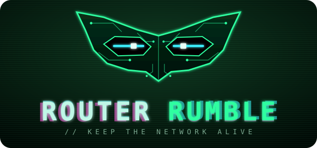

<p align="center"></p>

# Router Rumble

> Keep the internet alive together, while the internet tries to kill you.

**Play it live:** https://router-rumble.onrender.com (open on the big screen, then scan the QR code
with phones). Hosted on Render's free tier: after ~15 min with no visitors it sleeps, and the first
load takes up to a minute, so open it a minute before playing. Every push to `main` redeploys it.

A co-op party game. One big screen shows a phosphor-green network control field with the Wi-Fi network:
an internet uplink, a row of access points (APs) and the devices hanging off them. Every player's
phone is a controller **and** a device on that network. Routers overload, crash, and the team
has to reroute traffic before the network health hits 0.

## Run it

```bash
npm install
npm start
```

- **Big screen:** open `http://localhost:3000/` on the laptop that's connected to the projector.
  It opens a **room** with a 4-letter code (shown big in the lobby).
- **Phones:** scan the room's QR code (it points to `http://<laptop-LAN-IP>:3000/play?room=CODE`),
  or open `/play` and type the code.
- Press **START SHIFT** (or `S`) once everyone has joined.

### Rooms and limits

- Every big screen hosts its own game. Open a second screen (another browser tab or another
  laptop) and you get a second room with its own code, QR and players. Rooms never mix.
- **Up to 10 players per room** (`MAX_PLAYERS_PER_ROOM`). Player 11 is told the room is full.
  More players = more APs (up to 8) and a little more traffic, and more people mashing FIX on the boss.
- **Up to 30 rooms per server** (`MAX_ROOMS`).
- Reloading the big screen keeps its room and players. If the big screen disappears, phones show
  "host offline"; after 3 minutes without it the room closes and phones go back to the join form.
- A phone that drops (screen lock, bad Wi-Fi) keeps its spot for 15 s and rejoins automatically.
- Server protections: max 20 inputs/s per phone, 64 KB max message size, a broken message is
  logged instead of crashing the server. `GET /api/health` shows rooms, players and memory.

**Load test:** `npm run loadtest -- --rooms 25 --players 10 --seconds 20` simulates full rooms
(screens sending state at 10 Hz, phones tapping 8×/s, a spammer, a 11th player). On a laptop,
25 rooms × 10 phones (250 players) kept every phone at ~10 updates/s with ~100 MB of memory.

Requires Node 20+. Optional: `cp .env.example .env` and fill in values.

**Windows:** the first time you run `npm start`, Windows Firewall asks whether Node may accept
connections. Allow it on **private networks**, or phones can't connect. If you clicked "Cancel",
allow `node.exe` under *Windows Security → Firewall → Allow an app through firewall*.

### When phones can't connect (venue Wi-Fi)

Venue Wi-Fi often isolates clients from each other. In order of preference:

1. **Phone hotspot:** connect the laptop and all phones to one phone's hotspot. Restart the
   server so the QR code picks up the new IP.
2. **Tunnel:** `cloudflared tunnel --url http://localhost:3000` (or `ngrok http 3000`), then set
   `PUBLIC_URL=https://<the-tunnel-host>` in `.env` and restart. The QR code now points to the
   tunnel.
3. **Wrong IP in the QR code** (VPN/virtual adapters): the server prints every candidate IP on
   startup. Set `PUBLIC_URL=http://<right-ip>:3000`.
4. **Nothing works:** press `D` for demo mode (bots play) and use the backup video.

### Playing over the internet (not just the same Wi-Fi)

Deploy the server anywhere that runs Node 20 and WebSockets (Render, Railway, Fly.io, a VPS):
build `npm install`, start `npm start`, and the host gives you `PORT`. Then open the deployed
URL on the big screen; QR codes automatically point at that same address (or set `PUBLIC_URL`).
Phones anywhere can join with the room code. Free tiers may sleep when idle: open the site a
minute before the demo. For a quick test from the laptop, a tunnel (above) works the same way.

### AI Incident Commander

Set `OPENAI_API_KEY` and `OPENAI_MODEL` in `.env`. The server calls the OpenAI Chat Completions
API with a 3 s timeout (`AI_TIMEOUT_MS`). With no key, a timeout or any error, the commander
silently uses the canned lines in `public/screen/commander.js`. The game never waits on the AI and
runs fully offline.

## Keys on the big screen

| Key | Does |
|---|---|
| `S` | Start from the lobby |
| `L` | Skip to the next level (debug / demo) |
| `D` | Demo mode: bots press buttons |
| `K` | Crash a random AP (debug) |
| `E` | Fire a random chaos event (debug) |
| `M` | Mute |
| `Esc` | Back to lobby |

## How it plays

- Each player owns an AP (with more APs than players, some own two and get a **Switch AP** button).
- **Controls unlock as you go:** level 1 only has **PUSH** and **FIX**; **BOOST** and **SEND** (moving
  devices) unlock on level 2 with a pop-up on every phone. Set per level with `controls` in `levels.js`.
- **Every tap gives feedback:** phones pop up "+50 BOT ZAPPED!", "CABLE FIXED!", "🔥 x3 STREAK!",
  "+10% ▶ AP-2" and buzz on real achievements.
- Phone buttons: **Push Left/Right** (+10% of local traffic to that neighbour, sticky, max 50%),
  **Pull Back** (reset to 0%), **Boost** (+50% capacity for 5 s, 20 s cooldown), **Fix** (tap fast
  to revive a crashed AP, or 10 taps to repair a cut cable next to you).
- Traffic flows **upstream**: devices → their AP → (neighbour AP) → internet uplink.
- Every device has its own demand. Devices **surge** at random (they grow on the map and turn
  yellow/red) and **new devices join** during the level.
- **Move devices from your phone:** your AP's devices are listed as chips (hungriest first,
  bigger text = more traffic). Tap one and the Push buttons turn into **SEND ◀ / SEND ▶** to the
  neighbouring AP; Pull Back becomes Cancel. You can only send devices off an AP you run.
- **Move devices on the big screen:** drag a device onto any AP's column, or click it and then
  click an AP (anything, anywhere: handy for the host and for demos).
- A moved device reconnects (offline for 1 s) and its traffic now lands on the new AP. Moving
  devices off a crashed AP brings them back online.
- An AP above capacity for 3 s crashes for 5 s. Its devices go offline and health drains.
- **Enemies (one rule: FIX zaps them).**
  - Level 1 is the slower onboarding round: learn to watch load, reroute traffic, and move devices
    before the first horned **minion** arrives. Tap FIX on its AP to zap it (2 taps).
  - Level 2 adds pressure gradually and introduces viruses; Level 3 is where the faster difficulty
    ramp begins.
  - Levels 2–3 add **viruses**. They eat bandwidth and can spread once to a neighbouring AP if
    players do not contain them in time. Level 3 sends tougher viruses more often.
  - Level 4 is the final boss, **OVERSEER** (an original character): a giant robot that docks onto an AP, drains it hard,
    and launches interceptor droids at the other APs. While it attacks, **everyone's FIX hits it**.
    Knock it down and its droids fall with it, but it returns stronger. Beat it 3 times to win
    (no timer on this level). Boss HP scales with the number of players.
- The phone shows exact load numbers; the big screen only shows bars and status words. Talk!
- Every player gets a randomized color for the room. It marks their phone identity, player icon,
  and name on the big screen; colors do not assign gameplay roles.
- Survive 90 s to clear a level. Health 0% = network down.

## Power-ups, daily challenge and leaderboards

**Power-up orbs** (levels 2–4, `powerups.js`): glowing orbs drift across the big screen *and*
every phone at once. The first player to tap one on their phone grabs it (+25 pts):

| Orb | Effect |
|---|---|
| 📡 HOTSPOT | a temporary Wi-Fi hotspot beside your AP: +40 capacity for 10 s |
| 🔒 VPN | encrypts your AP for 15 s: bots and viruses can't latch on or spread through it |
| 🛡 ANTIVIRUS | scans the whole network and wipes every bot, virus and droid |
| ⚖ LOAD BALANCER | evens out traffic across all APs for 6 s |

**Daily challenge** (`daily.js`): one level + one twist per UTC day, the same for every team
in the world (the day also fixes the random seed). Twists: Surge Storm, Brownout (no BOOST),
Viral Day, Crowded Café, Power Hour, Lag Spikes, Boss Rush. Play it from the lobby's
**▶ DAILY CHALLENGE** button; best scores go on the Daily board.

**Leaderboards**: Today / This week / All-time / Daily, top 10 each, with a team name the host
types (or rolls with 🎲) in the lobby. Every finished run is stored by `scores.js`:

- **Upstash Redis** (free) when `UPSTASH_REDIS_REST_URL` and `UPSTASH_REDIS_REST_TOKEN` are set:
  permanent, survives restarts and deploys. **Use this on Render**, whose free tier wipes its disk.
  Setup: create a free database at [upstash.com](https://upstash.com) → copy the *REST URL* and
  *REST token* → paste them into the Render service's **Environment** tab.
- Otherwise `data/scores.json` (git-ignored): fine on your own machine.

The server rejects impossible scores and one submission per room every 5 s, but since any
browser can be a big screen, the boards aren't cheat-proof. Fine for a party game.

## Architecture

```
Phone (/play) ──socket.io──▶ server.js ──socket.io──▶ Screen (/)
  buttons, private view  ◀──  relay only, QR, AI  ◀──  AUTHORITATIVE sim + render
```

- **server.js**: rooms, relays messages within a room, assigns player IDs, QR codes, AI proxy.
  No game logic, so it stays light even with many rooms.
- **Screen** runs its room's simulation at 10 Hz and renders at 60 fps. Sends all phones'
  private states as one batch 10×/s; the server splits it per phone.
- **Phone** sends inputs, shows `player:state` (incl. pop-up messages), vibrates on crash and achievements.
- **Sound**: synthesized effects plus an adaptive soundtrack (`audio.js`) that speeds up and gets
  busier as health drops, chaos hits or the boss attacks. No audio files. `M` mutes.

### Files and owners

| Owner | Area | Files |
|---|---|---|
| **A** | Server, phone UX, networking, QR/tunnel, haptics | `server.js`, `public/play/*` |
| **B** | Simulation, levels 3–4, chaos events, enemies, role shuffle, difficulty | `public/screen/sim.js`, `levels.js`, `events.js`, `devices.js`, `enemies.js` |
| **C** | Visuals/juice, sound, commander personality, post-incident report | `public/screen/render.js`, `style.css`, `audio.js`, `commander.js` |
| shared | Socket protocol: **change only here, tell the team** | `public/shared/protocol.js` |
| shared | Phase machine, wiring, demo bots, debug keys | `public/screen/main.js` |

```
router-rumble/
├── server.js
├── scores.js                   leaderboard storage (Upstash Redis or data/scores.json)
├── scripts/loadtest.js         fake screens + phones to stress the server (npm run loadtest)
├── scripts/balance.js          headless difficulty check for every level + daily twist (npm test)
├── public/shared/protocol.js   event names, actions, phases, PlayerState typedef
├── public/screen/
│   ├── index.html, style.css   compact HUD, network map, incident drawer, operators
│   ├── operator-ghost.png      original low-opacity background art for the map
│   ├── main.js                 sockets, lobby → countdown → playing → levelEnd/gameOver
│   ├── sim.js                  pure sim: createState(), tick(state, dt, inputs), playerView()
│   ├── levels.js               level table (data only)
│   ├── devices.js              device weights + factory (demand lives on devices)
│   ├── enemies.js              minions, spreading viruses + OVERSEER boss and droids
│   ├── powerups.js             power-up orbs: HOTSPOT, VPN, ANTIVIRUS, LOAD BALANCER
│   ├── daily.js                daily challenge: one level + twist + seed per UTC day
│   ├── events.js               chaos events (start/each/end hooks)
│   ├── render.js               canvas map, packets, sparks, HUD panels
│   ├── commander.js            line queue, AI requests, canned lines
│   └── audio.js                synthesized SFX + adaptive music
└── public/play/
    ├── index.html, play.css
    └── play.js                 join, controls, private AP view
```

### Tuning (owner B)

- `TUNING` at the top of `sim.js`: overload/crash timings, boost, health drain, player scaling.
- `levels.js`: per-level demand, waves, spikes, event schedule, unlocked controls, tutorial prompts.
- **Run `npm test` after any tuning change.** It plays every level with 2, 6 and 10 players, both
  with a competent bot team and with an idle team, and fails if good play can't clear a level
  (under 80% of runs) or if doing nothing earns stars (no free wins).
- `sim.js` is pure (no DOM, seeded RNG), so you can run it in Node to balance levels:

```js
import { createState, tick } from './public/screen/sim.js';
import { LEVELS } from './public/screen/levels.js';
const s = createState({ level: LEVELS[0], players: [{ playerId: 'a', name: 'A' }, { playerId: 'b', name: 'B' }] });
while (!s.result) tick(s, 0.1, []);
console.log(s.result, s.health, s.crashes);
```

### Not done yet (the Codex phase)

- Levels 3–4 are drafts in `levels.js` (they load and play, but are untuned).
- Role shuffle (from the brief) is not implemented.
- Real sound, additional art polish, TTS for the commander.

## Logo

The hacker mask (`public/shared/mask.svg`) is an original design drawn for this game.
`public/shared/logo.svg` is the full lockup (mask + title).

## Rules

- Never commit `.env` or API keys. Keys stay on the server.
- Original assets only: the network is drawn in code, the operator background is original generated art, and sounds are synthesized.
